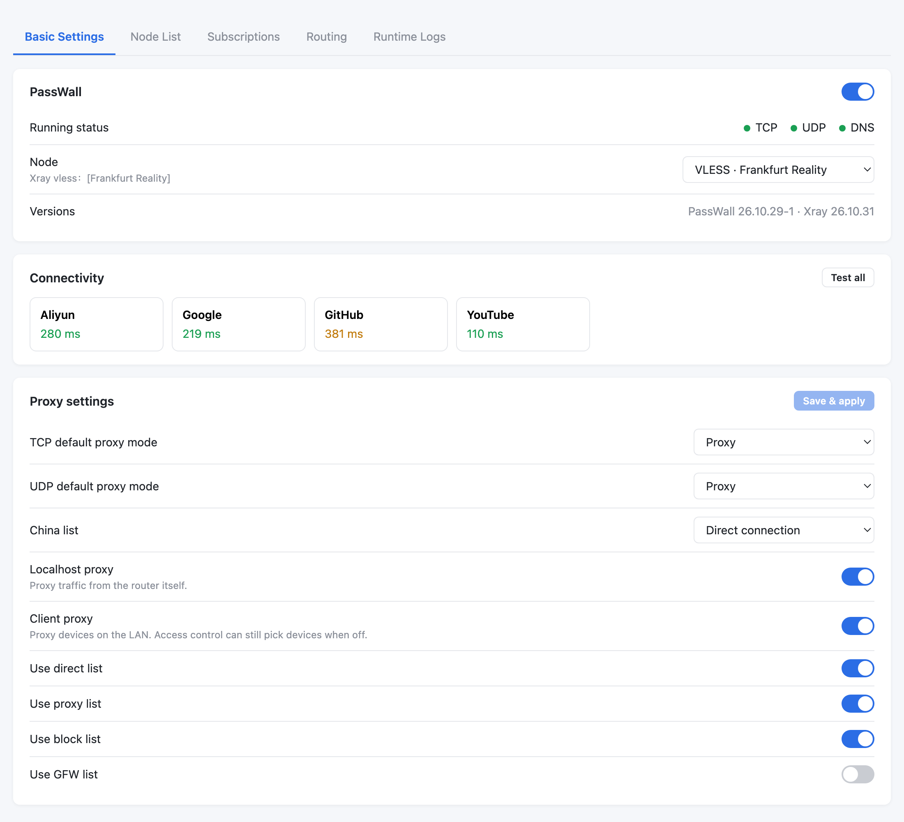
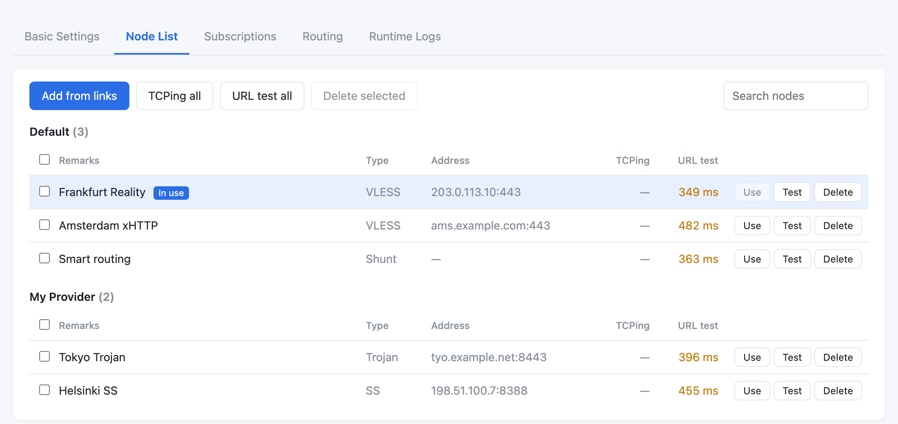
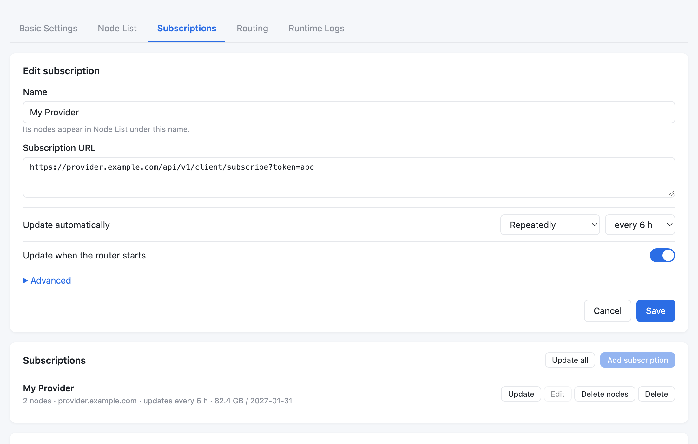
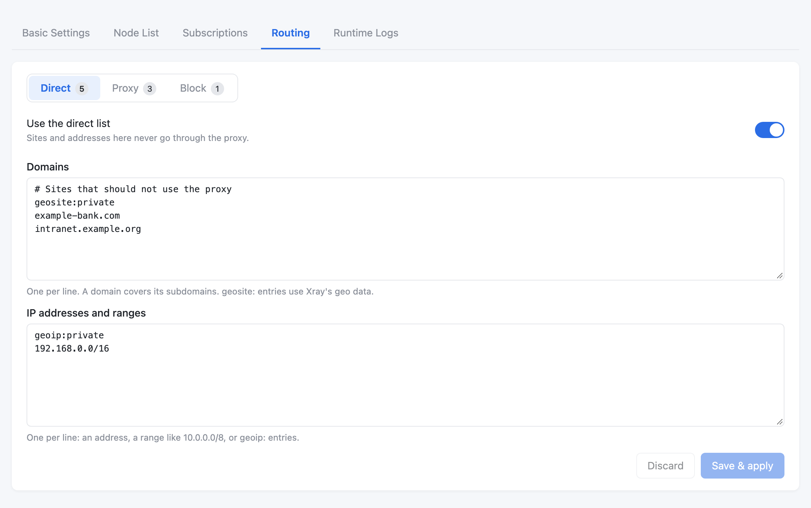
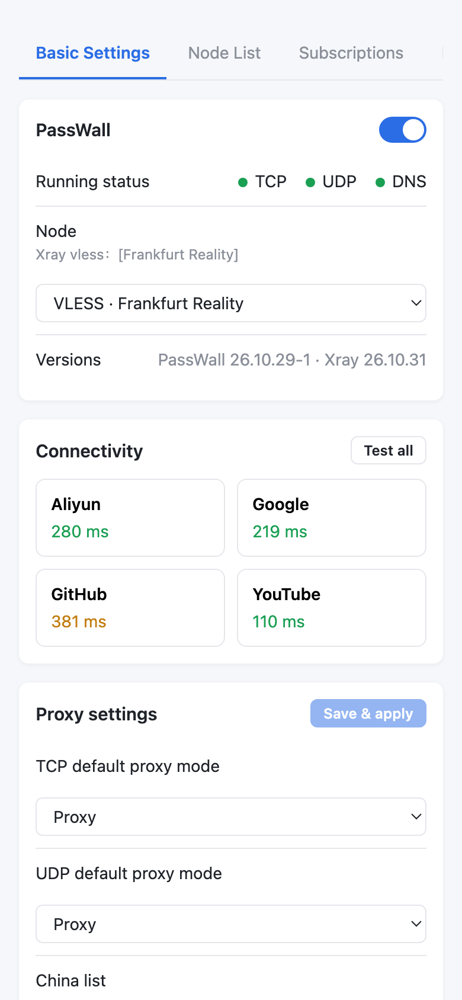

# PassWall for GL.iNet

PassWall with the Xray core, as a page inside the GL.iNet 4.x admin panel. Add your nodes or
subscription, pick one, switch it on: devices on your network, and the router itself, go
through the proxy, with lists for what goes direct, through the proxy, or gets blocked.



<sub>Screenshots use sample data.</sub>

## What you get

- **A PassWall page under VPN → PassWall** in GL's own admin panel, next to GL's other VPN
  options, and usable from a phone.
- **Nodes**: import share links (`vless://`, `vmess://`, `trojan://`, `ss://`, `hysteria2://` and
  more), test them (TCPing and URL test), switch between them.
- **Subscriptions**: add your provider's subscription URL, update it on a schedule or by hand,
  filter nodes by name.
- **Routing**: domain and IP lists for **Direct**, **Proxy** and **Block**, including
  `geosite:` and `geoip:` entries.
- **Connectivity checks** for Google, YouTube, GitHub and Aliyun, and the **runtime log**.
- **Everything else PassWall can do** (DNS options, access control, shunt rules, the Xray node
  editor and more) stays available in PassWall's original LuCI pages while the GL page grows.

| Node list | Subscriptions |
|---|---|
|  |  |

| Routing | On a phone |
|---|---|
|  |  |

## Supported routers

Built for GL.iNet routers whose 4.x firmware is based on OpenWrt 21.02 and uses the
`aarch64_cortex-a53` package architecture.

| Router | Firmware | Status |
|---|---|---|
| GL-MT3000 (Beryl AX) | 4.8.1 | Tested |
| Other GL.iNet 4.x routers with `aarch64_cortex-a53` on OpenWrt 21.02 | | Untested |

The installer checks the firmware, the architecture and the free space, and stops without
changing anything if they don't match. To see your router's architecture, run
`opkg print-architecture` over SSH.

## Install

Download the files from the **[latest release](../../../releases/latest)**. Two ways to install;
pick one.

### From the browser (LuCI)

Uses one file: `passwall-gl-full_<version>_aarch64_cortex-a53.ipk`.

1. Open `http://192.168.8.1:8080` and sign in with your router's admin password.
   If nothing loads, LuCI isn't installed yet: GL's admin panel can install it under
   **System → Advanced Settings**.
2. Go to **System → Software** and click **Update lists…** (the router needs internet for a few
   small packages from GL's own feed).
3. Click **Upload Package…**, choose the `.ipk` file, and install it.
4. Open the GL admin panel and go to **VPN → PassWall**.

### Over SSH

Uses the bundle: `passwall-gl-<version>-aarch64_cortex-a53.tar.gz`. From a Mac or Linux
computer on the router's network, in the folder with the file:

```sh
cat passwall-gl-*-aarch64_cortex-a53.tar.gz | ssh root@192.168.8.1 \
  'cd /tmp && tar -xzf - && sh passwall-gl-*-aarch64_cortex-a53/install.sh'
```

Type the router's admin password when asked. Each release's notes also have a one-line command
that downloads the bundle straight onto the router.

## First steps

1. **Back up** your router's settings first: **System → Backup / Restore** in the GL panel.
2. Open **VPN → PassWall**. PassWall starts switched off.
3. Add nodes: **Node List → Add from links**, or **Subscriptions → Add subscription**.
4. Optionally click **Test** next to a node to check it works from your router.
5. In **Basic Settings**, choose the node and turn on the **PassWall** switch.
6. Click **Test all** under Connectivity to confirm sites load through the proxy.

If something goes wrong, turn the switch off. The admin panel stays reachable while PassWall is
on, because local traffic never goes through the proxy.

## Updating and removing

- **Update**: install the new release the same way you installed the first one. Your nodes and
  settings are kept. The two ways don't mix: to switch, remove PassWall first.
- **Remove**: `ssh root@192.168.8.1 sh /usr/share/passwall-gl/uninstall.sh`. It stops PassWall,
  removes its packages and undoes the settings PassWall changed during install.

## Troubleshooting

| Problem | What to do |
|---|---|
| No PassWall entry under VPN | Reload the admin panel; sign out and back in if needed. |
| "PassWall's backend didn't answer" | Try again. Details are in `/tmp/passwall-gl.err` on the router. |
| A subscription adds no nodes | Check **Runtime Logs**: it shows what the provider returned. Some providers need a different User-Agent (Subscriptions → Edit → Advanced). |
| Sites don't load with PassWall on | Run **Test all** and test the node. Switching PassWall off restores normal internet. |
| Traffic doesn't go through the proxy | On the GL-MT3000 this works with hardware acceleration on. On other models, try turning acceleration off in GL's network settings. |
| Settings the GL page doesn't have yet | PassWall's LuCI pages: `http://192.168.8.1:8080/cgi-bin/luci/admin/services/passwall`. |

## Privacy and security

- Everything runs on your router. The page talks only to the router's own admin interface,
  behind GL's login.
- PassWall runs as root, as router software does. The GL page checks every value before it
  reaches PassWall, and anything that ends up in a shell command is checked or quoted first.
- Settings backups contain your Wi-Fi password and node keys. Keep them private.

## Building from source

See [docs/DEVELOPMENT.md](../docs/DEVELOPMENT.md): how it fits together, building with Docker,
the release workflow, and notes on GL's firmware.

## License and credits

GPL-3.0, like [PassWall](https://github.com/Openwrt-Passwall/openwrt-passwall), which this is a
fork of. Releases include [Xray](https://github.com/XTLS/Xray-core) (MPL-2.0) and other
components under their own licenses; each release lists them in `SOURCES.txt` and ships their
sources.

This project is not affiliated with or endorsed by GL.iNet or the PassWall project.
